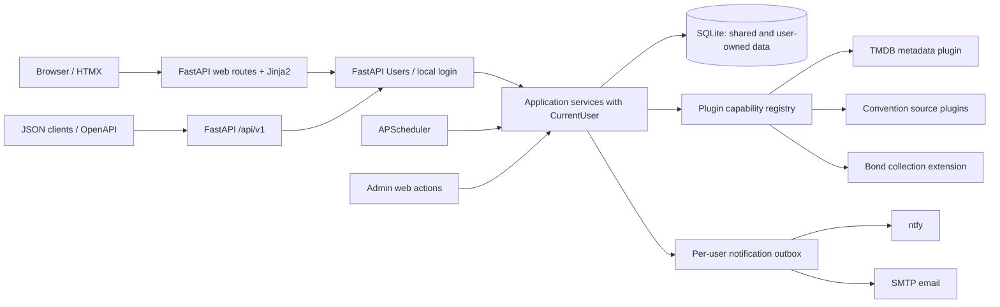

# CastTrail — High-Level Design

**Status:** Draft / implementation handoff  
**Version:** 0.12  
**Date:** 2026-10-27  
**Audience:** Developer, reviewers, coding agents

## Project naming and availability

**Chosen project name:** CastTrail. The application, repository, Python distribution/import package, plugin entry-point group, and examples use `casttrail` consistently. Prior StageDoor naming has been retired.

**Availability note (2026-10-27):** An earlier preliminary check did not identify a prominent exact-name competing product or published PyPI distribution. This is **not** trademark clearance or a guarantee that GitHub names, PyPI registration, or domains are available. Verify official registries and relevant jurisdictions before a public release.

## MVP scope decision (v0.10)

**Simplify delivered features, not architectural foundations.** The MVP includes the typed plugin API, independently packaged providers discovered through Python entry points, persistent external identities, provenance-bearing source observations, conservative cross-source reconciliation, manual corrections that survive resync, and **two convention discovery providers**. This avoids redesigning ingestion when further sources are added. The initial two providers must be chosen after validating actual source access and data quality; do not assume either is reliable without fixtures.

**Generic collections are core functionality** for any film or TV series (e.g. *Warehouse 13*, *Top Secret!* and optionally *Stranger Things*). **Only James Bond has special rules**, delivered by `casttrail-bond`: one unique in-person signer per film in each user's independent poster collection. The MVP does **not** require Bond scarcity scoring, guest assignment optimisation or adjustable weights.

**MVP notifications:** ntfy only, one enabled destination per user, immediate matching-appearance alerts, a durable idempotent delivery outbox, retries and a simple delivery status. Preserve provider-neutral event/outbox boundaries for future email and digests, but do not build SMTP or a general channel-preference UI in the MVP.

**MVP administration:** basic unresolved-identity listing, manual link/unlink/reject and correction persistence, source health, and manual refresh. Defer candidate-scoring engines, elaborate review histories and full reconciliation dashboards; store minimal durable rejection/override decisions now so the future workflow can build on them.

**Deferred without architectural rewrites:** extra providers and organiser-site templates (Showmasters, Monopoly Events and other similarly structured sites), reusable selector configurations, advanced identity heuristics, Bond ranking/optimisation, SMTP/digests, collection sharing/comparison, and elaborate scheduling controls. Shared scraping utilities and provider configuration should support multiple event URLs per plugin when needed, but **do not implement a generic scraper engine for MVP**. An organiser is not necessarily a single HTML layout: validate each before reusing parsing logic.

## Release versioning and progressive schema delivery (v0.12)

**Application releases use CalVer through the existing `calver-scm` project.** During pre-stable development use the configured `0.YYYY.M.patch` style (illustrative: `0.2026.10.0`, `0.2026.10.1`); after a deliberate stable-release decision use the configured stable CalVer style. Exact tag syntax and version derivation must be verified against the installed `calver-scm` version; tags are authoritative and release versions are not tied to work-package numbers. Expose application version, commit/build metadata and schema revision on an authenticated system-status page (public health must not disclose sensitive configuration).

**The independently distributed `casttrail-plugin-api` uses SemVer**, initially `0.x`, with a documented compatibility policy and an explicit breaking-change review before `1.0.0`. Provider plugins may use CalVer independently, but must declare compatible `casttrail-plugin-api` dependency ranges; do not infer compatibility from provider release dates. A plugin's metadata/version and its contract version are separate concepts.

**Schema is designed conceptually upfront but implemented incrementally.** WP-00 configures SQLAlchemy async, SQLite and Alembic with a reproducible migration command, but does not create all planned domain tables. Each subsequent usable vertical slice introduces only the tables, constraints and indexes it needs. The conceptual entity inventory in §8 is a *target model*, not a WP-00 schema checklist. Migrations are core-owned, versioned by Alembic revision identifiers (not application CalVer), tested on fresh databases and populated databases from the previous release. Use SQLite-compatible Alembic batch operations when required. Plugins emit typed observations; provider installation does not run arbitrary plugin-owned migrations.

**Delivery invariant:** every WP ends with a runnable application, user-visible outcome, migration upgrade test where applicable, and working existing features. WP-05 (second convention provider) should need **no new core tables** under normal circumstances: this explicitly tests the provider and provenance model. For per-WP migration ownership see the LLD.

## 1. Product summary

A small, multi-user, self-hosted application that watches selected people, films, television series and curated franchises; discovers convention guest appearances from external sources; identifies relevant UK events; and alerts each user to new actionable appearances. A separately packaged Bond collection extension supports independent poster collections for the owner and their dad (and other users), each tracking one **different**, **in-person** signer per poster across the 25 official Eon Bond films, optionally including two non-Eon films (27 total). Post-MVP ranking may prioritise films and guest opportunities by scarcity and urgency.

**Success means:** each user can sign in, maintain a private watchlist and independent Bond poster collection, add a film, see matching UK guest appearances, correct a wrong identity match, receive a nonduplicate alert, and see which unsigned Bond posters have matching upcoming guests. Scarcity ranking is a later enhancement.

**Non-goals:** public multi-tenant SaaS, ticket booking, automated purchases, universal collectibles management, an event bus, generic workflow engine, distributed workers, and scraping every convention worldwide.

## 2. Design principles and constraints

- Small modular monolith: one FastAPI application, one SQLite database, one scheduler in a single worker.
- Python 3.14, `uv`, standard `src/` packaging, a small `uv` workspace for independently packaged plugins.
- SOLID/DRY/KISS where useful; constructor injection for services; `Protocol` only at meaningful extension boundaries.
- Core owns persistence, canonical identity, matching, user isolation, notification state and scheduler. Plugins supply external observations or optional collection-specific logic.
- Server-rendered Jinja2 + HTMX, Pico CSS and a consistent Lucide icon set; minimal custom CSS and JavaScript. A versioned JSON API is exposed alongside HTML/HTMX routes.
- Manual corrections and explicit negative matches always take precedence over automated inference.
- Treat third-party pages as untrusted input; respect site terms, robots policies and reasonable request limits. Do not assume scraping is permitted or that an API exists.
- Prefer understandable SQLAlchemy queries and pure Python rules over premature repositories, generic buses or CQRS.
- Multiple users share scraped metadata and appearances, but watches, collections, signatures, notification channels and delivery history are private per user.
- Local authentication is the MVP; Authentik/OIDC or trusted proxy authentication is a deferred option, not an MVP dependency. No application CLI.

## 3. User stories and acceptance criteria

| ID | Story | Acceptance criteria | Phase |
|---|---|---|---|
| US-01 | As a user, I can search TMDB for a person or production. | Search displays candidate identity, credits and source; selection persists a canonical record. | 1 |
| US-02 | I can watch a person, film, series or curated franchise. | Watches are editable; production/franchise watches resolve associated people without duplicating manual watches. | 1 |
| US-03 | I can filter discovery to the UK. | Only GB events appear in default matching results; country settings are editable. | 2 |
| US-04 | I can see matching convention guests. | Each match shows event, dates, source, person and **why** it matched. | 2 |
| US-05 | I can review ambiguous identities. | Name-only/uncertain matches enter a review queue and cannot generate confirmed alerts. | 2 |
| US-06 | I can correct a false TMDB match. | I can unlink, remap, reject candidate or create a local person; subsequent syncs preserve my decision. | 2 |
| US-07 | I can merge duplicate people/events. | A reviewed merge reattaches references and dependent records transactionally; conflicting mappings require review. | Later |
| US-08 | I receive an alert for a newly discovered matching appearance. | Repeated syncs do not resend it; delivery attempts and errors are visible. | 3 |
| US-09 | I can see cancellations and corrections. | Explicit source cancellation changes appearance state; missing listings alone do not imply cancellation. | 3 |
| US-10 | I can see scraper health. | Per-source last success, last error, last attempt and fetched item counts are visible. | 2 |
| US-11 | I can track a 25- or 27-film Bond poster collection. | Each poster has status and a recorded signer; a signer cannot count toward two posters. | 4 |
| US-12 | I can record a signature obtained in person. | Record includes signer, film, date, optional convention and notes; eligibility can be manually overridden with explanation. | 4 |
| US-13 | I can rank unsigned Bond films by urgency. | Rank uses film age, living eligible signers, surviving cast age and observed convention scarcity; shows evidence quality. | Later |
| US-14 | I can rank upcoming Bond guest opportunities. | Each guest shows eligible outstanding posters, suggested assignment and why; no automatic permanent allocation. | Later |
| US-15 | I can change ranking weights. | Weights validate and scores recompute deterministically. | Later |
| US-16 | As an admin, I can trigger a refresh manually. | Admin UI invokes the same service as scheduler, prevents overlapping runs and reports outcome. | 2 |
| US-17 | As a user, I can sign in with a local account. | Secure password verification, cookie authentication and logout; public registration is disabled. | 0 |
| US-18 | As a user, my watches and collection are private. | Another user cannot read or change my watches, signatures, preferences or notifications. | 1 |
| US-19 | As an admin, I can manage local users. | Create, disable and assign admin access; disabling prevents further access. | 0 |
| US-20 | As an admin, I can correct shared identity matches. | Corrections affect shared canonical records without changing anyone’s personal collection choices. | 2 |
| US-21 | As a user, I can configure ntfy and email destinations. | Add, test, enable or disable personal channels; secrets are protected. | Later |
| US-22 | As a user, I can choose alert types and channels. | New appearances, cancellations and Bond opportunities respect per-user preferences. | Later |
| US-23 | As a user, I can track my own Bond posters independently of other users. | My completed posters, chosen signers and eligibility overrides do not affect another user’s progress. | 4 |
| US-24 | As a user, I can see whether my dad also needs a poster signer only if he explicitly shares that information. | Private by default; only collections explicitly shared with me are visible. | Phase 5 |
| US-28 | As a Bond collector, I can share my collection progress read-only with another user. | Explicit grant and revoke; recipient sees signed/unsigned posters and signer details; cannot edit; revocation takes effect on the next request. | Phase 5 |
| US-29 | As a Bond collector, I can compare shared collections and identify convention guests relevant to either or both. | Side-by-side film progress and independently calculated opportunities; only authorized collections included; no merging or automatic signer allocation. | Phase 5 |

### Example acceptance scenario: incorrect identity

**Given** a convention source guest named “Alex Smith” was auto-linked to TMDB person X; **when** the user rejects X and selects TMDB person Y; **then** the source identity maps to Y, X is recorded as rejected, matching opportunities are recalculated, the previous incorrect alert is marked superseded, and a later import cannot silently revert to X.

## 4. Conceptual architecture



**Pipeline:** provider fetch → validated observation → external identity resolution → canonical convention/appearance upsert → watch matching → collection opportunities → notification outbox → delivery.

A source observation is not automatically a verified identity or a confirmed announcement. `first_seen_at` means first observed by this app, not necessarily the organiser's announcement time.

## 5. Runtime and dependencies

| Concern | Choice |
|---|---|
| Python / package management | Python 3.14, uv workspace, one `uv.lock` |
| HTTP/UI | FastAPI, Uvicorn (single worker), Jinja2, HTMX, Pico CSS, Lucide icons |
| JSON API | `/api/v1/*`, Pydantic v2 request/response models, generated OpenAPI (`/openapi.json`, `/docs`) |
| Data | SQLAlchemy 2 async, SQLite + aiosqlite, Alembic |
| Validation/config | Pydantic v2, pydantic-settings |
| Network/parsing | HTTPX, selectolax; only add browser automation if permitted and needed |
| Scheduling | APScheduler, one in-process scheduler |
| Notifications | Built-in ntfy + SMTP adapters, per-user preferences, persistent outbox |
| Authentication | FastAPI Users, local email/password, secure HTTP-only cookie, database-backed tokens; no public signup |
| Tooling | Ruff, mypy, pytest, Import Linter, Poe, uv_build |

Use WAL and SQLite busy timeout where appropriate; back up the database before migrations. Keep scheduled jobs short, bounded and non-overlapping. For one-worker deployment, no distributed coordination is required.

## 6. Repository and packaging

```text
casttrail/
├── pyproject.toml                 # application + workspace root
├── uv.lock
├── .python-version
├── src/casttrail/
│   ├── main.py                    # composition root / lifespan
│   ├── config.py
│   ├── database.py
│   ├── api/v1/                  # versioned JSON endpoints + Pydantic schemas
│   ├── auth/                     # FastAPI Users, sessions, admin user management
│   ├── notifications/            # outbox, ntfy and SMTP adapters
│   ├── models/                   # SQLAlchemy persistence models
│   ├── identity/                 # resolution, decisions, correction
│   ├── services/                 # discovery, watches, matching, alerts
│   ├── plugins/                  # loader + registry, not concrete plugins
│   ├── jobs/                     # scheduler adapters
│   └── web/                      # routes, templates, static
├── packages/
│   ├── casttrail-plugin-api/
│   ├── casttrail-tmdb/
│   ├── casttrail-rostercon/
│   ├── casttrail-comiconomicon/
│   └── casttrail-bond/
├── migrations/
└── tests/
```

The root is an installable application and depends on selected plugins. Each plugin depends **only** on `casttrail-plugin-api` and its own libraries, never on the root app or other concrete plugins. This avoids circular package dependencies. The shared API contains contracts and DTOs, not application services.

```toml
# root pyproject.toml (excerpt; versions constrained when scaffolded)
[project]
name = "casttrail"
version = "0.1.0"
requires-python = ">=3.14"
dependencies = ["casttrail-plugin-api", "casttrail-tmdb", "fastapi", "uvicorn", "sqlalchemy[asyncio]", "aiosqlite"]

[project.optional-dependencies]
bond = ["casttrail-bond"]
conventions = ["casttrail-rostercon", "casttrail-comiconomicon"]

[tool.uv.workspace]
members = ["packages/*"]

[tool.uv.sources]
casttrail-plugin-api = { workspace = true }
casttrail-tmdb = { workspace = true }
casttrail-bond = { workspace = true }
casttrail-rostercon = { workspace = true }
casttrail-comiconomicon = { workspace = true }

[build-system]
requires = ["uv_build>=0.9,<0.10"] # replace with compatible current pinned range
build-backend = "uv_build"
```

Pin a verified `uv_build` version when scaffolding; the range above is a placeholder, not a claim about the latest release.

### Entry points

```toml
# packages/casttrail-rostercon/pyproject.toml
[project]
name = "casttrail-rostercon"
version = "0.1.0"
requires-python = ">=3.14"
dependencies = ["casttrail-plugin-api", "httpx", "selectolax"]

[project.entry-points."casttrail.plugins"]
rostercon = "casttrail_rostercon.plugin:create_plugin"

[tool.uv.sources]
casttrail-plugin-api = { workspace = true }
```

A plugin may register multiple capabilities; do not force one exclusive `PluginKind`.

## 7. Plugin contracts and lifecycle

Use `importlib.metadata.entry_points(group="casttrail.plugins")`; no directory scanning or arbitrary module import strings. Installed plugins are trusted code, not sandboxed. Discovery → instantiate enabled factories → register capabilities/routes/jobs → startup → shutdown. No runtime hot-installation.

```python
# casttrail_plugin_api/contracts.py
from collections.abc import Sequence
from dataclasses import dataclass
from datetime import date
from decimal import Decimal
from enum import StrEnum
from typing import Protocol
from pydantic import BaseModel

class AppearanceStatus(StrEnum):
    ANNOUNCED = "announced"
    CONFIRMED = "confirmed"
    CANCELLED = "cancelled"
    UNKNOWN = "unknown"

class GuestObservation(BaseModel):
    provider: str
    external_id: str | None = None
    name: str
    source_url: str
    attendance_days: list[date] | None = None
    autograph_available: bool | None = None
    autograph_price: Decimal | None = None
    status: AppearanceStatus | None = None

class ConventionObservation(BaseModel):
    provider: str
    external_id: str
    name: str
    country_code: str
    starts_at: str  # use date in production
    source_url: str

class ConventionProvider(Protocol):
    async def list_conventions(self, countries: frozenset[str]) -> Sequence[ConventionObservation]: ...
    async def list_guests(self, convention_external_id: str) -> Sequence[GuestObservation]: ...

class MetadataProvider(Protocol):
    async def search_people(self, query: str) -> Sequence["PersonCandidate"]: ...
    async def get_production_credits(self, external_id: str) -> Sequence["CreditObservation"]: ...

class PluginContext(Protocol):
    def add_convention_provider(self, name: str, provider: ConventionProvider) -> None: ...
    def add_metadata_provider(self, name: str, provider: MetadataProvider) -> None: ...
    def add_router(self, router: object) -> None: ...  # refine to APIRouter in host-facing API

# PersonCandidate and CreditObservation are shared Pydantic DTOs in models.py.
```

Keep host-specific FastAPI route/job registration in a small optional host extension contract; source providers need not depend on FastAPI. Prefer passing an application service facade to collection extensions rather than raw SQLAlchemy sessions. Route registration occurs before serving requests; scheduler jobs are registered before scheduler start.

```python
# src/casttrail/plugins/loader.py
from importlib.metadata import entry_points

def discover_factories() -> dict[str, object]:
    result: dict[str, object] = {}
    for ep in entry_points(group="casttrail.plugins"):
        if ep.name in result:
            raise ValueError(f"Duplicate plugin: {ep.name}")
        result[ep.name] = ep.load()
    return result
```

Factory invocation and context construction belong in the composition root; do not assume no-argument plugin constructors.

## 8. Data model

**Conceptual target only:** the following inventory describes eventual entities; do not create these tables in WP-00. The LLD assigns minimum schema changes to each vertical slice.

Minimal persistent concepts:

| Entity | Key fields / relationships |
|---|---|
| `person` | id, display_name, birth_date?, death_date?, local metadata overrides |
| `production` | id, title, type (film/series), release_date?, franchise association |
| `credit` | person_id, production_id, role, source, eligibility override? |
| `franchise` / `franchise_production` | manually curated franchise membership |
| `watch` | user_id, target_type, target_id, enabled; country filter per user |
| `convention` | id, name, location, GB country code, start/end dates, official URL? |
| `appearance` | person_id?, convention_id, status, first_seen_at, last_seen_at |
| `appearance_source` | appearance_id, provider, source external key/URL, reported status, observed timestamps |
| `external_identity` | provider, entity_type, external_id, canonical entity ID?, resolution method |
| `identity_decision` | source identity, candidate canonical entity, accepted/rejected, timestamp, reason |
| `notification_event` | shared appearance/correction event with stable dedupe key |
| `user_notification` | user_id, event_id, read_at; unique (user_id, event_id) |
| `notification_channel` | user_id, type (ntfy/email), destination/config, enabled, verified_at |
| `notification_preference` | user_id, event_type, channel_id, delivery mode |
| `notification_delivery` | user_notification_id, channel_id, status, attempts, next_attempt_at, delivered_at, error |
| `user` | id, email, display_name, is_active, is_superuser; local auth managed by FastAPI Users |
| `access_token` | database-backed FastAPI Users authentication token records |
| `collection` / `collection_item` | collection.user_id; each user has independent Bond poster items, linked production and status |
| `signature` | owned through collection item; person, obtained date, convention?, notes, in-person evidence |
| `collection_eligibility_override` | collection_id, production_id, person_id, include/exclude, reason; personal, not global |
| `collection_share` (Phase 5) | collection_id, grantee_user_id, permission=`view`, created_at; unique (collection_id, grantee_user_id); owner remains on collection |
| `sync_run` | provider, started/finished, outcome, counts, error summary |

**Ownership:** all personal records are accessed through the authenticated user; check ownership on read, update and delete. Shared identity corrections are admin-only. The same signer may be used in different users’ collections, but never twice within one user’s Bond collection.

Enforce unique external identity `(provider, entity_type, external_id)` and unique notification dedupe key. Use foreign keys and transactional corrections. Provider-specific raw payloads may be stored in bounded diagnostic fields only if helpful; do not build a full event store.

### Identity resolution

1. Resolve exact verified external identity first.
2. Check explicit rejected associations and manual locks.
3. Use stable cross-provider identifiers where available.
4. Generate candidates from names and supporting credits; **name-only matches are not trusted**.
5. Leave ambiguous guests unresolved; show review UI and suppress confirmed alerts.
6. On manual remap, re-evaluate affected appearances, matches and rankings; preserve notification history with a superseded state.

Do not model a rejected candidate as a rejected *external identity*. It is a negative association between an external identity and a proposed canonical person.

### Deduplication and source reliability

Conventions and people may appear across multiple providers. Maintain separate source observations and canonical records. A missing listing is not proof of cancellation; only explicit reliable cancellation evidence changes a confirmed appearance to cancelled. Store evidence URLs and observation timestamps. Where sources disagree, show the conflict for review.

## 9. Matching and notification flow

```python
async def refresh_provider(provider, identity_service, appearance_service, matcher, outbox):
    observations = await provider.list_conventions(frozenset({"GB"}))
    for convention in observations:
        canonical_event = await appearance_service.upsert_convention(convention)
        for guest in await provider.list_guests(convention.external_id):
            person = await identity_service.resolve(guest)
            appearance = await appearance_service.record(canonical_event, guest, person)
            if person is None:
                continue  # requires review; no confirmed alert
            for user_match in await matcher.match_users(appearance):
                await outbox.enqueue_once(
                    user_id=user_match.user_id,
                    dedupe_key=user_match.dedupe_key,
                    match=user_match,
                )
```

This is illustrative orchestration, not a production transaction design. Implement bounded concurrency, retries/backoff, provider rate limits, and transaction scopes in the service layer. Avoid holding a database transaction open during HTTP requests.

**Multi-user matching:** discovery runs once for all users. The matcher resolves each appearance against enabled per-user watches and Bond collections, then creates independent user notifications. Never broadcast personal matches or collection status to other users.

**Alert semantics:** `newly discovered appearance` is different from `newly relevant match` caused by adding a watch. Default to alerts for newly discovered matches; show pre-existing matches in the UI without mislabeling them as announcements. Preserve an outbox delivery log; use idempotency keys to prevent duplicate notifications.

## 10. Bond collection extension

### Rules

- Seed the 25 official Eon films; optional two non-Eon theatrical films (27 total).
- One qualifying signature per poster, from a **different person** for each poster.
- In-person signatures only; a signed item can include date, event and notes.
- Film eligibility derives from credits plus explicit manual inclusions/exclusions (including uncredited/stunt performers).
- Each user makes the final signer-to-poster choice in their own collection. Suggested assignments are not reservations.
- The owner and their dad both pursue the Bond poster challenge, with **separate progress, signer choices, ranking and notification preferences**. One person signing a poster for the owner does not prevent that same person signing a different poster for their dad. Uniqueness is **per collection**, not global.
- Personal signer-eligibility overrides must not silently modify shared film credits or another user’s eligibility.

### Film urgency scoring (post-MVP)

Configurable initial weights (sum to 1):

| Factor | Weight | Interpretation |
|---|---:|---|
| Film age | 0.15 | Older film gets greater urgency |
| Surviving eligible signer scarcity | 0.30 | Fewer known living eligible signers means higher urgency |
| Surviving cast age | 0.20 | Older known living cast raises urgency |
| Convention scarcity | 0.35 | Fewer known recently active convention signers raises urgency |

Scores are heuristic, not objective probabilities. Use bounded, smoothed normalization and show underlying counts, last verified dates and data-completeness indicators. **Unknown death status or absent convention history must not be treated as deceased or definitively inactive.**

### Guest opportunity ranking (post-MVP)

For each upcoming confirmed guest, list all eligible unsigned posters and suggest the most useful assignment using film urgency, signer age, observed signing frequency and opportunity uniqueness. Later use maximum bipartite matching to optimise across available guests and outstanding posters; never assign the same signer twice. Expose explanations, not only scores.

```python
from dataclasses import dataclass

@dataclass(frozen=True)
class RankingWeights:
    film_age: float = 0.15
    surviving_scarcity: float = 0.30
    cast_age: float = 0.20
    convention_scarcity: float = 0.35

    def __post_init__(self) -> None:
        if any(v < 0 for v in vars(self).values()):
            raise ValueError("Weights must be nonnegative")
        if abs(sum(vars(self).values()) - 1.0) > 1e-9:
            raise ValueError("Weights must sum to 1")
```

The ranking implementation should be pure Python over prepared inputs, easily unit tested independently of SQLAlchemy.

## 11. UI / UX

### Visual design and frontend conventions

**Decision:** use [Pico CSS](https://picocss.com/) for semantic, responsive styling and [Lucide](https://lucide.dev/) for **all interface icons**. Avoid Bootstrap, Tailwind, component frameworks, icon-font mixes, and a bespoke design system. Keep HTMX + Jinja2 server-rendered; add custom CSS only where Pico cannot express the requirement (poster grid, compact status badges, comparison table, icon alignment).

- Prefer semantic HTML: `<main class="container">`, `<nav>`, `<article>`, `<form>`, `<table>`, `<dialog>` and native labels/buttons. Use Pico defaults for typography, spacing, forms, and light/dark theme support.
- Use one consistent Lucide icon family with the same stroke weight and typical size (e.g. 18–20px). Examples: `layout-dashboard`, `eye`, `calendar-days`, `clapperboard`, `bell`, `users`, `settings`, `search`, `check`, `alert-triangle`, `external-link`, `pencil`, `refresh-cw`.
- Icons complement **visible text** on important actions; icon-only controls require an accessible name (`aria-label`) and tooltip/title. Never communicate status solely through colour or icon shape.
- Prefer locally served, pinned CSS and SVG assets; avoid requiring a public CDN at runtime. For Lucide, vendor only icons actually used, or build a small local SVG sprite. Do not embed arbitrary user/provider-supplied SVG.
- Provide reusable Jinja2 partials/macros for navigation items, icons, status badges, flash messages, empty states and forms. Keep templates simple and use HTMX only for interactions that benefit from partial updates.
- Responsive behaviour: mobile-first layout, accessible keyboard focus, readable tables (scroll container where necessary), and system light/dark preference. Avoid decorative animation and excessive cards.

**Illustrative base template:**

```html
<!doctype html>
<html lang="en" data-theme="auto">
  <head>
    <meta charset="utf-8">
    <meta name="viewport" content="width=device-width, initial-scale=1">
    <link rel="stylesheet" href="{{ url_for('static', path='css/pico.min.css') }}">
    <link rel="stylesheet" href="{{ url_for('static', path='css/app.css') }}">
    <script defer src="{{ url_for('static', path='js/htmx.min.js') }}"></script>
    <title>CastTrail</title>
  </head>
  <body>
    <header class="container">
      <nav aria-label="Main navigation">
        <ul><li><strong>CastTrail</strong></li></ul>
        <ul><li><a href="/watches">Watches</a></li>
            <li><a href="/conventions">Conventions</a></li>
            <li><a href="/bond">Bond</a></li></ul>
      </nav>
    </header>
    <main class="container" id="main-content">
      
    </main>
  </body>
</html>
```

**Illustrative icon macro** (icons are trusted, pre-vendored files or sprite symbols, never arbitrary filenames from user input):

```html

<svg class="icon" width="20" height="20" aria-hidden="true" focusable="false">
  <use href="/static/icons/lucide.svg#{{ name }}"></use>
</svg>


<button type="submit">{{ icon('refresh-cw') }} Refresh appearances</button>
```

The sprite is a **build artifact** containing only approved Lucide symbols; do not assume a Lucide distribution ships this exact sprite layout. Render icons as decorative when paired with text. Use explicit `aria-label` for icon-only buttons.

**Small CSS override example:**

```css
.icon { display: inline-block; vertical-align: -0.2em; margin-inline-end: .35rem; }
.poster-grid { display: grid; grid-template-columns: repeat(auto-fill, minmax(11rem, 1fr)); gap: 1rem; }
.status-badge { display: inline-block; padding: .15rem .5rem; border-radius: .4rem; border: 1px solid currentColor; }
```

Main navigation: **Dashboard · Watches · Conventions · Bond Collection · Notifications · Account**. Admins also see **Identity Review · Admin/System · Users**.

```text
┌─────────────────────────────────────────────────────────────────┐
│ CastTrail                                          │
│ Dashboard  Watches  Conventions  Identity Review  Bond  Settings │
├─────────────────────────────────────────────────────────────────┤
│ New matching appearances: 3  │ Upcoming UK events: 12            │
│ Identity reviews: 5          │ Last sync: 14:05                  │
├─────────────────────────────────────────────────────────────────┤
│ Guest             Event                  Match reason            │
│ Example Guest     London Event           Bond: Goldfinger        │
│ [View appearance] [Open source] [Correct identity]               │
├─────────────────────────────────────────────────────────────────┤
│ My Bond posters: 4 / 25    Priority: Dr. No (limited evidence)    │
│ [View priority ranking] [Upcoming eligible signers]              │
└─────────────────────────────────────────────────────────────────┘
```

### HTMX search example

```html
<form hx-get="/watches/search" hx-target="#search-results" hx-trigger="submit">
  <label for="query">Find an actor, film or series</label>
  <input id="query" name="q" required minlength="2">
  <button type="submit">Search</button>
</form>
<div id="search-results" aria-live="polite"></div>
```

### FastAPI partial endpoint

```python
from fastapi import APIRouter, Depends, Request
from fastapi.responses import HTMLResponse

router = APIRouter()

@router.get("/watches/search", response_class=HTMLResponse)
async def search_watches(request: Request, q: str, service=Depends(get_watch_service)):
    results = await service.search(q)
    return templates.TemplateResponse(
        request=request,
        name="watches/_search_results.html",
        context={"results": results},
    )
```

`get_watch_service` and `templates` are application composition dependencies defined in the web package. Add CSRF protection to state-changing forms and require an authenticated FastAPI Users session for personal pages; require admin for shared corrections and provider operations. Treat all imported descriptions and URLs as untrusted; Jinja2 autoescaping stays enabled.

### Identity review screen

Show source name, source URL, event, candidate TMDB images/credits, confidence/evidence, and actions **Confirm**, **Reject**, **Search another**, **Create local person**, **Unlink**. Show a clear manual-override badge. Use POST for changes and HTMX swaps for inline updates.

### Bond screen

Poster grid with unsigned/completed status, urgency badge, known eligible signers and upcoming UK opportunities. A ranking table should expose *film, living-known, unknown-status, convention-active-known, oldest/median ages, evidence quality, priority score*; do not present unverified counts as fact.

## 12. JSON API and HTML/HTMX interfaces

**Decision:** expose a **versioned JSON API** under `/api/v1` as well as full HTML pages and HTMX fragments. The JSON API is part of the product, not a later retrofit. Implement endpoints incrementally alongside the associated features; do **not** duplicate every web action purely for symmetry.

```text
Browser ──► FastAPI web routes ──► Jinja2 full pages / HTMX fragments
                                      │
JSON client ──► FastAPI /api/v1 ───────┤
                                      ▼
                            Shared application services
                                      │
                            Database + plugin capabilities
```

Both interfaces enforce the **same authentication, ownership and authorization** and call the **same Python services directly**. Web/HTMX handlers must **never** call `/api/v1` over HTTP internally. Keep response formatting in the adapters: Pydantic response schemas for JSON, Jinja2 templates for HTML. Avoid leaking ORM objects into stable public API contracts. API routes are not a bypass for identity review or per-user access checks.

| Capability | JSON endpoint | HTML / HTMX endpoint |
|---|---|---|
| Search people | `GET /api/v1/people?q=...` | `GET /people`, `GET /people/results` |
| Person detail | `GET /api/v1/people/{id}` | `GET /people/{id}` |
| Conventions | `GET /api/v1/conventions` | `GET /conventions` |
| Appearances | `GET /api/v1/appearances` | `GET /appearances` |
| Own watches | `GET/POST /api/v1/watches` | `GET/POST /watches` |
| Collection detail | `GET /api/v1/collections/{id}` | `GET /collections/{id}` |
| Bond opportunities | `GET /api/v1/collections/{id}/opportunities` | `GET /collections/{id}/opportunities` |
| Notifications | `GET /api/v1/notifications` | `GET /notifications` |
| Identity review (admin) | `GET /api/v1/admin/identities` | `GET /admin/identities` |

**Example: shared service and two presentation adapters** (illustrative dependency names):

```python
class PersonService:
    async def search(self, query: str) -> list[Person]:
        ...

@api_router.get("/people", response_model=list[PersonResponse])
async def search_people_json(q: str, service: PersonServiceDep):
    people = await service.search(q)
    return [PersonResponse.model_validate(person) for person in people]

@web_router.get("/people/results")
async def search_people_partial(
    request: Request, q: str, service: PersonServiceDep
):
    people = await service.search(q)
    return templates.TemplateResponse(
        request, "people/_results.html", {"people": people}
    )
```

Expose OpenAPI documentation via FastAPI's `/openapi.json`, `/docs` and optionally `/redoc`. Configure documentation exposure for the deployment; sensitive endpoints always require authentication even if the schema is visible. **Initially both interfaces use FastAPI Users' authenticated browser cookie**. Browser cookie authentication requires CSRF protection on state-changing requests. API tokens and machine-to-machine authentication are deferred until there is a concrete use case. Use conventional pagination and explicit filtering for list endpoints; avoid speculative GraphQL or API version negotiation.

**Additional acceptance criteria:** JSON and HTML search return consistent underlying results; user A cannot access user B's records through either interface; admin endpoints reject non-admin users; generated OpenAPI accurately describes shipped JSON routes; HTMX fragments render independently without relying on HTTP calls to the JSON API.

## 13. Multi-user access and notification channels

### Local authentication

Use **FastAPI Users** with SQLAlchemy async and database-backed cookie authentication. Local email/password login is the only MVP method; no public registration. An admin creates/enables accounts. Use its `is_superuser` capability for the simple Admin/User distinction, without building a general RBAC engine. Use secure, HTTP-only cookies, CSRF protection for state-changing browser requests, rate limiting for login, and safe password recovery/admin reset flows. The application owns user-scoped authorization checks even though FastAPI Users handles authentication. Authentik via OIDC or trusted proxy is **deferred**, and must not be implemented speculatively.

```python
# Illustration: resolve current user for web handlers
current_user = fastapi_users.current_user(active=True)
current_admin = fastapi_users.current_user(active=True, superuser=True)

@router.get("/my/bond")
async def my_bond_collection(user: User = Depends(current_user)):
    return await bond_service.get_collection_for_user(user.id)
```

### Per-user Bond collection example

```text
Shared: Dr. No (1962), cast credits, guest appearances
  ├── User A / Bond Collection
  │     ├── Dr. No poster: signed by Person X
  │     └── Goldfinger poster: unsigned
  └── User B / Bond Collection
        ├── Dr. No poster: unsigned
        └── Goldfinger poster: signed by Person Y
```

Enforce a uniqueness rule for completed signer IDs **within each collection**, not across all users. The owner's and dad's collection data are independent even when they watch the same actor or attend the same convention. A read-only shared comparison view is planned for Phase 5; no shared ownership or editing.

### Optional family collection sharing (Phase 5)

The owner and their dad can **opt in** to sharing Bond progress without merging collections. A collection is private by default. Its owner may grant or revoke **view-only** access to a specific existing user; no public sharing links or group permissions in v1. A grant never gives access to editing, notification settings, or other private data.

**Comparison view:** show a film-by-film table with one column per authorized collection, completion counts, signer names for completed posters, and independently computed outstanding opportunities. An upcoming guest may be marked relevant to **you**, **dad**, or **both**. A shared opportunity is a comparison of two independent recommendations, not a reservation or a shared signature record.

```text
BOND COLLECTION COMPARISON — shared with you
Film                      You                     Dad
Dr. No (1962)             Outstanding             Signed — Person A
From Russia with Love     Signed — Person B       Outstanding
Goldfinger (1964)         Outstanding             Outstanding

Upcoming guest: Person C — Goldfinger
  You: eligible / outstanding    Dad: eligible / outstanding
  Both could benefit; each collection retains its own signer assignment.
```

**Minimal data model:** `collection_share(collection_id, grantee_user_id, permission='view', created_at)`, unique on `(collection_id, grantee_user_id)`. Owner access is derived from `collection.user_id`; do not create redundant owner grants. Validate that a grantee exists and is active. No separate RBAC framework.

**Authorization:** every comparison query must select only the current user's own collection(s) or collections with an active explicit share to that user. Check permission on every read, including HTMX partials and opportunity endpoints; never accept an arbitrary collection ID without checking access. Only the owner may grant/revoke. Revocation is effective on subsequent requests, with no cross-user cache leakage. Shared view does not expose personal watches, private notes, notification channels, or eligibility-override reasoning by default.

**Tests:** private collection is inaccessible; grant permits read but not write; revocation blocks read immediately; comparison excludes unauthorized collections; recommendations and signer uniqueness remain independent; shared opportunity matches both collections only when each is independently eligible.

### Notifications

**MVP restriction:** implement ntfy immediate delivery only. The SMTP, multi-channel preferences and digest contracts below describe a later extension, not MVP deliverables.


Use a single application-owned notification service with two small adapters: **ntfy** (HTTP push) and **SMTP email**. Each user can configure their own destinations and choose which event types to receive on each channel. Initial event types: new matching appearance, explicit cancellation, and new Bond opportunity. Digest scheduling is optional later. Store a durable per-user notification and per-channel delivery record, with bounded retries and idempotency keys. An external send can be retried after a timeout, so do not promise exactly-once delivery.

```python
class NotificationChannel(Protocol):
    async def send(self, destination: str, message: NotificationMessage) -> None: ...

# Provider-neutral dispatch; actual destination configuration is loaded
# from the authenticated user's notification_channel records.
await notification_service.enqueue_for_user(
    user_id=user_match.user_id,
    event=appearance_event,
)
```

UI: **Account → Notification Channels** (add/test/disable ntfy topic or email address) and **Account → Notification Preferences** (per event/channel). Keep secrets out of templates and logs. Validate ntfy topics and configure authentication for private topics; do not allow arbitrary user-provided destination URLs to become server-side HTTP requests.

### Security/ownership acceptance tests

- User A cannot read, edit or delete User B's watches, collections, signatures or notification channels, even by guessing IDs.
- The same actor may sign one poster in each user's collection, but cannot satisfy two posters within the same collection.
- Disabling a user blocks access; non-admin users cannot correct shared identities or trigger global provider refreshes.
- A single shared appearance generates independent notifications only for matching users and their enabled channels.

## 14. Background jobs and operations

| Job | Initial cadence | Notes |
|---|---|---|
| Discover GB conventions | Daily | Fetch source event listings |
| Refresh guests | Every 6–12 h | Per-source rate limits and conditional requests |
| Refresh TMDB metadata | Weekly | Do not overwrite manual corrections |
| Deliver outbox | Every 5 min | Retry bounded failures; idempotent |
| Refresh ranking snapshot | Daily or after affected changes | Cache only if profiling justifies it |

Admin UI refresh actions and scheduled jobs call the same services. Expose provider health, manual refresh and job status in the admin UI. **No CLI is in scope.**

Deployment: Docker Compose, bind-mounted SQLite data directory, single Uvicorn worker, health endpoint, logs, configurable timezone and backup. Avoid scheduler startup in multiple worker processes.

## 15. Architecture and behavioural tests
### Engineering quality gates (mandatory)

**Reuse existing tooling:** Bootstrap CastTrail’s Ruff, strict mypy, pytest/coverage configuration, Poe the Poet task patterns and prek hooks from the read-only Menagerist `feature/initial-implementation` branch. Adapt rather than blindly copy: CastTrail uses a smaller FastAPI/Jinja2 workspace, SQLite and plugin packages. Introduce basic checks in WP-00 and activate glob-based application-area coverage gates as the relevant areas land. Coverage targets are measured on executable production code; no empty-glob pass. Keep all quality checks in CI and available as local Poe tasks.


CastTrail targets Python 3.14 with complete annotations on application and plugin public interfaces and all functions/methods (including return types). Enforce `ruff check`, `ruff format --check`, and `mypy --strict` across every workspace package; narrow third-party typing exceptions must be documented and scoped, never blanket `ignore_errors`. Use typed Pydantic DTOs at boundaries and avoid `Any` unless justified.

Use pytest with branch coverage (`pytest-cov`, `--cov-branch`), reporting **both repository-wide and application-area coverage**. Minimum branch-coverage targets: **90% overall**; **95%** for identity/reconciliation, appearance matching/deduplication, notification rules/outbox/retries, authentication/authorization, generic collection ownership, and Bond-only signer rules/ranking; **90%** scheduling; **85%** provider parsing/adapters, database adapters, and JSON/HTMX presentation handlers. Exclude migrations, generated code, and pure declarative configuration only with an explicit justification. These thresholds apply to executable code in each area, not just the test suite associated with it.

Coverage is a supporting metric, not proof of correctness. Require negative cases, concurrency/idempotency, two-user isolation, ambiguous source identities, unavailable providers, and CSRF/permission checks. CI fails on Ruff, strict mypy, architecture tests, failing tests, overall coverage or any area below its threshold. If a new application area has little code, require tests immediately rather than hiding it behind global coverage.


Use **Import Linter** for a small number of package boundaries and pytest for behaviours. Enforce:

1. `casttrail_plugin_api` imports neither core nor concrete plugins.
2. Concrete plugins do not import core or each other.
3. Core does not statically import concrete plugin packages; dynamic entry-point loading is allowed.
4. Business services/identity do not import FastAPI, Starlette, Jinja2 or web modules.
5. Provider plugins do not import SQLAlchemy or write the application database.
6. All configured entry points load and register unique capabilities.
7. Plugin packaging manifests do not introduce core/plugin-to-plugin dependencies.

Core behavioural tests: verified identity survives sync; rejected candidate stays rejected; ambiguous guest produces no confirmed alert; same appearance from two sources deduplicates; missing source listing does not cancel; outbox dedupes; Bond signer cannot count twice; rankings are deterministic; unknown cast data lowers confidence rather than implying death/inactivity.

```toml
# Example import-linter contract
[tool.importlinter]
root_packages = ["casttrail", "casttrail_plugin_api", "casttrail_tmdb", "casttrail_bond"]

[[tool.importlinter.contracts]]
name = "Core must not import concrete plugins"
type = "forbidden"
source_modules = ["casttrail"]
forbidden_modules = ["casttrail_tmdb", "casttrail_bond"]
```

Expand the configured root packages and plugin list as they are scaffolded. Run `uv run lint-imports` in CI. Import checks complement, but do not replace, behaviour tests.

## 16. Incremental delivery plan — usable checkpoints

**Database rollout:** C0 prepares Alembic without domain tables; C1 creates authentication tables; C2 creates TMDB identities/people/productions/credits/watches; C3 creates convention/appearance/observation/source-run tables; C4 adds only matching/manual-correction persistence required; C5 reuses the same core schema for a second provider; C6 adds notification/outbox persistence; C7 adds collection/signature tables; C8 hardens migrations and restore procedures. Each slice can adjust its exact table list based on actual implementation needs, with an ADR for material deviations. Application CalVer releases may occur between or across checkpoints; Alembic revisions remain independent.


**Delivery rule:** each work package must finish with a runnable, navigable application and an observable user outcome. No multi-package "big bang" before anything can be demonstrated. Earlier functionality must keep working at every checkpoint; no feature is considered done if it exists only as an API or a background task with no usable UI/status. The app starts locally with a documented `uv run poe` command and a seeded/demo or configured test path; CI runs Ruff, strict mypy, tests and applicable branch-coverage thresholds throughout. Fixtures are acceptable for demonstration when live third-party access is unavailable, but must be visibly labelled as fixture data.

| Checkpoint | What a user can actually do after this chunk | What's added | Not required yet |
|---|---|---|---|
| **C0 — Running shell (WP-00)** | Open CastTrail in a browser, see a home/status page, confirm discovered plugins and health; run all quality commands | uv workspace, plugin API and entry points, FastAPI, HTML shell, SQLite connection/migration baseline, Poe/prek/CI | Real user data, discovery |
| **C1 — Personal app (WP-01)** | Sign in as an admin-created user, sign out, navigate the responsive UI, view an empty dashboard; separate accounts cannot access each other's pages | Local auth, sessions/CSRF, ownership, UI navigation, coverage checker | TMDB, providers |
| **C2 — Watchlist (WP-02)** | Search TMDB for an actor or film/TV series; watch/unwatch it; revisit a persisted personal watchlist | TMDB plugin, people/productions/credits, external identities for TMDB, web + minimal JSON routes | Conventions, alerts |
| **C3 — Convention browser (WP-03)** | Browse upcoming UK events and guests imported from **one** provider; see source links, last refresh, unresolved identity labels and known attendance/autograph details | Durable observations, provider scheduler/manual refresh, source health, first convention plugin | Automated notifications, cross-source dedupe |
| **C4 — Relevant opportunities (WP-04)** | See a personalised *possible/relevant appearances* page for watched people/productions; manually link or reject an ambiguous guest as admin; corrected results survive refresh | Conservative identity resolution, admin correction, matching, no alerts for unresolved people | Second provider, ntfy |
| **C5 — Two-source discovery (WP-05)** | See one canonical event/appearance backed by two independent sources, with provenance and conflicting/unknown details displayed safely; browse sources separately | Second convention plugin, cross-source reconciliation, idempotent resync | Sophisticated field ranking |
| **C6 — Notifications (WP-06)** | Configure an ntfy destination, receive a nonduplicate alert for a new relevant appearance, inspect delivery status/retry | Outbox, retries, deduplication, immediate ntfy | Email/digests |
| **C7 — Collecting (WP-07)** | Create generic film/TV collections and record autographs (*Warehouse 13*, *Top Secret!*); independently maintain Bond posters with unique in-person signers and see matching guests | Generic collection UI and Bond-only extension | Bond scarcity ranking, sharing |
| **C8 — Deployable MVP (WP-08)** | Install via Docker Compose, restore backup, use two accounts end-to-end, verify source failures/cancellations do not erase good data | Operational/security hardening, full fixture/coverage gates, docs | Advanced features |

**Provider detail from day one, without overbuilding:** the observation contract has optional attendance days, autograph availability, price and explicit status/cancellation fields. `None` means *unknown*, not *no*. Preserve raw source evidence and provenance. Comiconomicon may provide discovery with limited detail while Roster Con may provide better attendance/autograph information; do not assume this for every event. Explicit cancellation differs from a missing listing. In C3–C5 show known details and unknowns; defer automated field-level conflict scoring, pricing history, booking, and organiser-specific scraper templates.

**Future slices:** additional aggregator and official-organiser plugins (Showmasters/Monopoly Events may support multiple configured event URLs per provider), advanced identity scoring/review, SMTP/digests, Bond scarcity/optimisation, opt-in family sharing/comparison. These build on retained plugin, identity, observation and notification contracts without becoming MVP dependencies.

## 17. Delivery estimates and AI-assisted execution

**Estimates are planning ranges, not benchmarks of a specific model.** A *developer-day* means approximately eight hours of effective implementation/review work, not eight hours of continuous model inference. Calendar duration depends on availability, subscription quotas, review cadence and source feasibility. **Sonnet 5.5 performance and Claude Pro usage limits are not assumed or guaranteed**; validate with a short implementation spike.

| Workstream | Experienced developer assisted by Sonnet 5.5 (dev-days) |
|---|---:|
| Foundation: workspace, auth, database, JSON + HTML shells, tests | 3–5 |
| TMDB integration, watches, search, credits, country settings | 3–4 |
| First convention source, normalization, dedupe, identity correction | 4–7 |
| ntfy/email, outbox, preferences, cancellation events | 2–4 |
| Bond collection, signature recording, basic opportunities | 3–5 |
| **Useful end-to-end first release (subtotal)** | **15–25** |
| Further providers, richer historical evidence and scarcity ranking | 5–9 |
| Matching optimisation, robust operational hardening, edge-case tests | 3–5 |
| Optional family sharing/comparison | 2–4 |
| **Full scoped product (planning allowance)** | **25–40** |

**Two delivery modes:**

- **Sonnet 5.5-assisted development:** a human developer owns decisions, provider feasibility checks, code review and acceptance; Sonnet drafts plans, implementation and tests. Budget **25–40 human developer-days** for the full scope, with some AI work happening inside those days. This is the more dependable planning baseline.
- **Agent-led implementation with Sonnet 5.5 (Claude Pro):** Sonnet authors most code and tests in small, reviewed chunks. A **15–25 working-day elapsed target for implementation** is plausible under favorable conditions, **plus 5–10 human review/integration days of effort** (some overlapping), but **not a reliable unattended completion estimate**. Subscription quotas, agent tooling, context handoffs and provider changes can extend calendar time significantly. Do not treat AI-generated tests as independent verification.

**Critical uncertainty:** third-party convention sources may prohibit scraping, change HTML, lack stable guest identifiers, or contain poor historical records. Verify at least one usable source before committing to the schedule. Other uncertainties: accurate Bond eligibility/survival data, safe identity merges, auth/session hardening, and completeness of historic convention attendance. A source requiring browser automation or manual verification can add several days.

**Recommended sequencing:** preserve the runnable checkpoints in §16: local login → TMDB watches → browse one provider → matching and correction → second provider → ntfy → collections; never postpone all UI until the final work package. Add Bond recording next, then scarcity scoring, extra providers and family sharing. Each agent chunk should have a testable acceptance criterion, explicit human review and a brief written handoff. Reserve time for production smoke tests with two distinct user accounts.

## 18. Open decisions and explicit assumptions

- **Source feasibility:** investigate current site terms, robots rules, APIs, page structure and rate limits before writing scrapers. Source compatibility is not yet validated.
- **Signer eligibility:** default to credited cast; allow manually verified crew, stunt and uncredited contributors. Decide exact collection policy in Phase 4.
- **Cast scarcity:** TMDB credits are incomplete and survival data is uncertain. Always display evidence quality and unknown counts.
- **Historical appearance activity:** absence of historical records does not prove a person no longer attends conventions.
- **JSON API:** versioned `/api/v1`, shared services and authorization, Pydantic schemas and OpenAPI; browser cookie auth initially, API tokens later if needed.
- **Authentication:** FastAPI Users local email/password authentication with database-backed cookie tokens, admin-managed users and no public registration. Authentik/OIDC remains a future option; do not implement it in MVP.
- **Collection sharing:** optional, explicit read-only collection sharing and side-by-side comparison are planned for Phase 5. Collections remain private by default, with independent signer rules and no shared editing.
- **Franchise grouping:** manual curation is supported; TMDB collections alone are not sufficient for all film/TV universes.
- **Plugin migrations:** no independent plugin-owned migrations in v1; core-owned collection tables and explicit extension data fields only.
- **Ranking weights:** proposed initial defaults, to be validated with real data.

## 19. Instructions for coding agents

1. **Read this document and the repository's `ARCHITECTURE.md` before changing code.** Preserve the dependency direction.
2. Implement only the requested phase/story. Do not pre-build speculative plugin hooks, event buses, repository layers, additional auth frameworks or distributed infrastructure.
3. Prefer existing standard-library, uv and FastAPI conventions. Use constructor injection at meaningful boundaries; no interface for every class.
4. For any external source, verify allowed access and save representative permitted test fixtures; never assume the source has a stable API.
5. Treat imported data as observations. Never overwrite manually verified identity decisions or eligibility overrides.
6. Keep algorithms pure where possible; test edge cases and data uncertainty explicitly.
7. After each coherent implementation chunk, record changed files, design decisions, tests run, remaining risks and next steps in the agent handoff or PR description.
8. Run formatting, linting, type checking, import-boundary checks and relevant tests before presenting work. Report failures honestly.
9. Do not commit, push, install new integrations, or modify external services without explicit user instruction.
10. If a requirement would materially expand the scope, propose the smallest workable alternative first.

### Definition of done for a story

- User-facing behaviour works through the relevant JSON and/or HTML interface for multiple local users; private data is isolated and shared corrections are admin-only.
- Data persists correctly and manual corrections survive re-sync.
- Appropriate tests pass, including architecture contracts.
- No new cross-plugin or plugin-to-core import dependency.
- Relevant UI is keyboard usable, uses Pico CSS and the shared Lucide icon set consistently, and displays provenance/error states.
- README or HLD is updated if an architectural decision changed.

---

**Architecture north star:** a source provider should be addable as a standard uv workspace package with an entry point and contract tests, without modifying core identity resolution, matching or notification logic.
